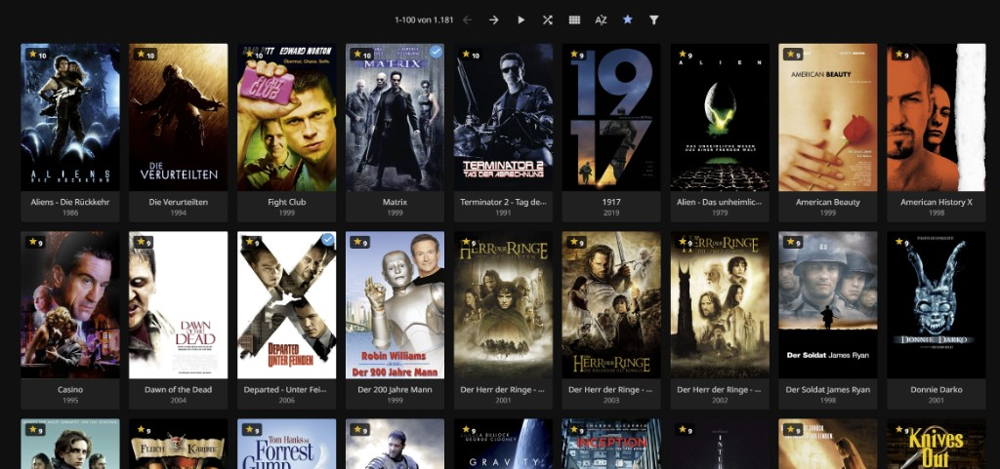

# Jellyfin Plugin: User Rating

[](LICENSE)

Community plugin for **Jellyfin 10.11**. No fork of `jellyfin/jellyfin-web`.

**https://github.com/crack666/jellyfin-plugin-userrating**

## Bring your IMDb ratings in — and see what you rated but do not own

Import your IMDb *Your Ratings* export and the plugin does two things.

It writes your scores onto the matching titles in your library. And it lists **every title you rated on IMDb that is not in your library at all** — sorted by your own score, highest first, with clickable IMDb links, paginated, and exportable as CSV.

That second list is the point of this plugin. It is a want-list assembled from your own taste rather than from a recommendation engine: the films you personally thought were worth an 8 or a 9, that you cannot actually watch on your own server. Nothing else in the Jellyfin ecosystem tells you that.

Everything below is in service of it — your scores are visible and sortable inside Jellyfin so the imported data is worth something day to day.



## Features

- **IMDb import and gap report:** Dashboard → Plugins → User Rating. Upload an IMDb *Your Ratings* CSV (`Const` + `Your Rating`). Dry-run first. Match is `ProviderIds.Imdb`. Only `UserData.Rating` is written; play state is left alone. Titles not in the library are listed with clickable IMDb ids, paginated (default 200 per page, size is selectable), highest score first. **Download CSV** exports the full sorted unmatched list (`Const`, `Title`, `Year`, `Title Type`, `Your Rating`). The title column is whatever IMDb put in the export (often localized).
- **Sort** by personal rating (menu entry *Personal rating* / *Eigene Bewertung*). Jellyfin 10.11 ignores `SortBy=UserRating` on the server, so the plugin loads the library and sorts in the browser.
- **Poster badge:** personal score on the cover. Hover by default; a star button in the library toolbar keeps badges visible. Sorting by personal rating turns that on automatically (toggle still wins). Preference is stored in the browser (`localStorage`).
- **Detail page:** score next to the community stars. Click it for a 10→1 picker.
- **Native clients (optional, off by default):** report the personal rating as `CriticRating` and/or `CommunityRating` so Android, FireTV, webOS and Chromecast can show and sort by it. Two separate switches, responses only, nothing written to the database — see [Native clients](#native-clients).

Ratings live in the existing per-user field `UserData.Rating` — the same value Jellyfin already stores. Nothing extra in the database.

## Requirements

- Jellyfin **10.11** (built against ABI 10.11.0, tested on 10.11.11)
- .NET 9 to build from source

## Install

### From the plugin repository (recommended)

Dashboard → Plugins → **Repositories** → **+**:

| Field | Value |
|---|---|
| Repository Name | `crack666` |
| Repository URL | `https://raw.githubusercontent.com/crack666/jellyfin-plugin-userrating/master/manifest.json` |

**User Rating** then appears under Dashboard → Plugins → **Catalog**. Install it there, restart Jellyfin, and hard-reload the web UI (**Ctrl+F5**). Every future version arrives as an update notification.

### Manually

Download the latest `Jellyfin.Plugin.UserRating_*.zip` from [Releases](https://github.com/crack666/jellyfin-plugin-userrating/releases), then Dashboard → Plugins → Catalog → gear → **Install from file**. Or build it yourself (below) and copy the DLL into a folder named `User Rating_<version>` under the server's `plugins` directory. Restart, then **Ctrl+F5**.

One caveat worth knowing: a plugin folder Jellyfin did not install itself **never updates automatically**. The server synthesises a manifest for such folders with `AutoUpdate = false`, so the update task skips them forever. Installing once from the repository fixes that permanently.

**Switching from a manual install loses nothing.** Ratings live in Jellyfin's own database (`UserData.Rating`) and settings in `plugins/configurations/Jellyfin.Plugin.UserRating.xml` — both outside the versioned plugin folder that gets replaced.

### TrueNAS SCALE (ix-jellyfin)

Plugins live in the container at `/config/plugins/` (host dataset, UID 568). Example:

`/mnt/…/apps/jellyfin/config/plugins/User Rating_1.2.0.0/Jellyfin.Plugin.UserRating.dll`

Restart the app after copying. Do not rewrite compressed `/web` HTML by hand — the plugin decompresses gzip/br before injecting its script.

## IMDb CSV

How to get the file (desktop site only — not in the IMDb app):

1. Sign in at [imdb.com](https://www.imdb.com).
2. Profile menu (top right) → **Your Ratings**.
3. Top right: **Export**, or the ⋮ menu → **Export**. You usually get `ratings.csv`. If nothing downloads, open [imdb.com/exports](https://www.imdb.com/exports/) and fetch it there.

Required columns:

- `Const` (e.g. `tt0133093`)
- `Your Rating` (1–10)

Optional but shown in the unmatched table: `Title`, `Year`, `Title Type`.

Always run **Check (dry-run)** before **Import**.

## Build

```powershell
dotnet build -c Release
```

Output: `bin/Release/net9.0/Jellyfin.Plugin.UserRating.dll`

Zip that DLL as `Jellyfin.Plugin.UserRating_1.2.0.0.zip` for Dashboard install-from-file.

## Native clients

Android, Android TV, FireTV, webOS, Chromecast and the rest render their own UI. None of them shows `UserData.Rating`, and `ItemSortBy` in 10.11 has no `UserRating` member, so there is nothing for them to ask the server for. What they *do* render — and offer in their sort menus — is `CriticRating` and `CommunityRating`.

Dashboard → Plugins → User Rating borrows one or both of those slots. Two independent switches, both off by default:

| Switch | Field | Scale | Visibility |
|---|---|---|---|
| **Use the critic rating field** | `CriticRating` | ×10 — a 9 shows as 90 | Discreet. Rarely populated, and many clients show it on the detail page only |
| **Use the community rating field** | `CommunityRating` | ×1 — shows unchanged | Prominent. The stars appear on detail pages *and* on cover art |

With a switch on, item responses carry your own score in that field, and `SortBy=<that field>` gets re-sorted by personal rating before the page goes out. Turn on both and every rating a client shows you is your own.

A hack, deliberately, and reversible by design:

- **Nothing is written to the database.** Responses are rewritten on the way out. The stored ratings stay intact and reappear on the next request once a switch is off — no re-import, no metadata refresh.
- Items you have not rated report *no* value rather than the real one. Otherwise a stray 87 reads like a score you gave.
- The web UI is not exempt: with the critic switch on it shows your score with a tomato icon, fresh from `Rating ≥ 6` and rotten below (jellyfin-web switches at 60); with the community switch on it replaces the stars.
- Sorting pulls the unpaged result to reorder it, capped at 20,000 items per query. Past that the server logs a warning and the tail is dropped.
- The genuine ratings are out of sight for every client while a switch is on. That is the trade, and it is the whole reason each field has its own switch.

### This part is meant to become obsolete

[jellyfin/jellyfin#17634](https://github.com/jellyfin/jellyfin/pull/17634) adds `ItemSortBy.UserRating`, a `minUserRating` filter and a numeric `rating` parameter to the server, with [jellyfin-web#8361](https://github.com/jellyfin/jellyfin-web/pull/8361) adding the UI. Once those land and clients pick them up, sorting and showing a personal rating stops being a workaround and becomes a server feature — and both switches above can go away.

That is a good outcome, not a threat to this plugin. Borrowing a rating field is a hack; the IMDb import and the gap report are not, and no upstream PR replaces them.

## Limitations

- Sort is client-side (server 10.11 does not honor `UserRating`).
- UI follows Jellyfin’s display language (`html lang`): English default, plus locale files in `Web/i18n/` (de, fr, es, it, nl, pt, pt-br, pl, ru, and others). Missing keys fall back to English.
- Not in the official Jellyfin plugin catalog yet (manual install).
- Out of the box only the Jellyfin **web UI** is touched (and clients embedding it, e.g. Jellyfin Media Player). Native apps need the [rating-field override](#native-clients), which is a workaround, not a feature Jellyfin supports.

## Compatibility

**KefinTweaks Watchlist** ([ranaldsgift/KefinTweaks](https://github.com/ranaldsgift/KefinTweaks)) collides with this plugin. Not a bug in either project — both write the same server field.

Jellyfin has no separate storage for `Likes`. `UserItemData.Likes` is a computed view over `UserData.Rating`:

- read: `Likes == (Rating >= 6.5)` (`UserItemData.MinLikeValue`)
- write: `Likes = true` sets `Rating = 10`, `Likes = false` sets `Rating = 1`
- `Filters=Likes` translates to SQL `Rating >= 6.5`

KefinTweaks keeps watchlist membership in `Likes`, so *being on the watchlist* is literally *rating ≥ 6.5*. With both installed:

- Rating an item 7–10 silently puts it on the watchlist; rating it 1–6 silently takes it off.
- Adding to / removing from the watchlist overwrites an existing personal rating with 10 / 1.
- Worst case: rating an **already played** item ≥ 7 falls back to 1 within a second. The rating write emits a `UserDataChanged` websocket event, and KefinTweaks listens on it to auto-remove played items from the watchlist.

This plugin has no way around it. It writes the field Jellyfin documents as *"users 0-10 rating"*, through the official endpoint, with a partial update that touches nothing else. Decoupling has to happen elsewhere: KefinTweaks moving the watchlist off `Likes`, or upstream promoting `UserData.Likes` — the database column already exists — to independent storage.

## Contributing

Issues and pull requests are welcome. Fork the repo and open a PR against `master`.

## Credit

Built by [crack666](https://github.com/crack666) with **Cursor / Grok 4.6**, against stock Jellyfin 10.11.

## License

GPL-3.0-or-later (required: the plugin links Jellyfin).
